# PLAN — docs/jp のブロック図一覧

`docs/jp/` の本文に描かれている図（ブロック図・フロー図・スタック図・木構造図・対応図）を、本文から**そのままコピー**して並べたもの。図の中身は一字一句変えていない（箇条書きの中に置かれた図だけは、箇条書きの字下げを外した）。行番号は図のコードブロックを開く行。

SVG で描き直した図は、ASCII 図の下に置いた。日本語版は `docs/images/diagrams/jp/fig-章-番号.svg`、英語版は `docs/images/diagrams/en/fig-章-番号.svg`（ここには日本語版を表示）。

## 収録の基準

- **収録した**: 枠（`+--+` や `┌─┐`）、線（`├─` `│`）、矢印（`→` `↓` `─→`）で描いた図。並べて対応関係を示す図。
- **収録しなかった**: アセンブリやコードの一覧（コメントに矢印があっても図ではない）、手順を書いた擬似コード（例: 5.4.1 の push / pop の並び、2.2.5 の gen_expr の追跡）、文法規則の表記、正規表現の例、インデントだけで表した AST ダンプ（`--dump-ast` の出力と同じ形のもの）。

全 35 図（うち SVG 版あり 35）: 対応図 1、ブロック図 4、フロー図 8、木構造図 15、スタック図 7

---

## 第1章 — 42を返すだけのコンパイラ

### 図 1-1. ソースコード → AST → アセンブリの対応

- **場所**: 第1章の表紙「`--dump-ast` で内部を覗く」（`docs/jp/ch01/00_overview.md` 99 行目）
- **種類**: 対応図

```
ソースコード         木 (AST)              アセンブリ
"int main() {        FUNC_DEF main         main:
  return 42;            BLOCK                 pushq %rbp
}"                        RETURN              movq %rsp, %rbp
                            INT_LIT 42        movl $42, %eax
                                              leave
                                              ret
```

SVG 版（日本語 `docs/images/diagrams/jp/fig-1-1.svg`、英語 `docs/images/diagrams/en/fig-1-1.svg`）:

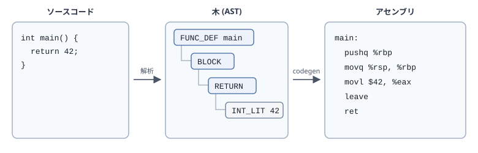

### 図 1-2. test.c から test.s までのパイプライン（縦）

- **場所**: 第1章の表紙「全体の流れ」（`docs/jp/ch01/00_overview.md` 128 行目）
- **種類**: ブロック図

```
+-----------+
| test.c    |  人間が書いた tiny-c ソース / int main() { return 42 ; }
+-----+-----+
      |
      v
+-----------+
| lexer.l   |  flex がCコードを生成
| (lex.yy.c)|  → 文字列をトークンに分解
+-----+-----+
      | int, main, (, ), {, return, 42, ;, }
      v
+-----------+
| parser.y  |  bison がCコードを生成
|(parser.tab|  → トークン列から木を組み立てる
| .c)       |  途中で ast.c のコンストラクタを呼ぶ
+-----+-----+
      |
      v
+-----------+
| Node 木   |  メモリ上の AST
+-----+-----+
      |
      v
+-----------+
| codegen.c |  木を辿ってアセンブリを出力
+-----+-----+
      |
      v
+-----------+
| test.s    |  x86 アセンブリ
+-----------+
```

SVG 版（日本語 `docs/images/diagrams/jp/fig-1-2.svg`、英語 `docs/images/diagrams/en/fig-1-2.svg`）:

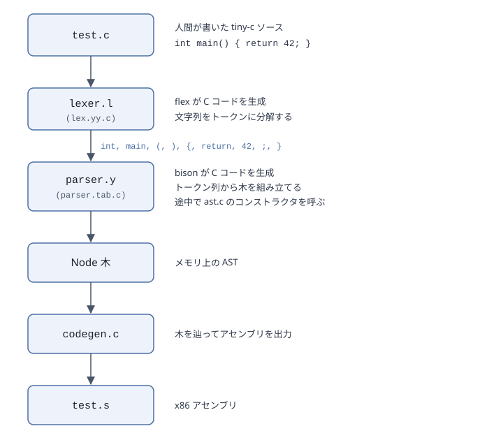

### 図 1-3. ソース文字列 → トークン列（字句解析）

- **場所**: 1.2 flex 入門 と lexer.l の冒頭（最初の項より前）（`docs/jp/ch01/02_flex.md` 7 行目）
- **種類**: フロー図

```
"int main() { return 42; }"
              ↓ 字句解析器
INT  IDENT(main)  '('  ')'  '{'  RETURN  INT_LIT(42)  ';'  '}'
```

SVG 版（日本語 `docs/images/diagrams/jp/fig-1-3.svg`、英語 `docs/images/diagrams/en/fig-1-3.svg`）:

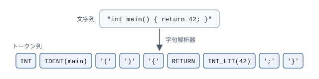

### 図 1-4. lexer.l → flex → lex.yy.c

- **場所**: 1.2 flex 入門 と lexer.l の冒頭（最初の項より前）（`docs/jp/ch01/02_flex.md` 15 行目）
- **種類**: フロー図

```
lexer.l   ─ flex ─→   lex.yy.c   （これが字句解析器の C コード）
```

SVG 版（日本語 `docs/images/diagrams/jp/fig-1-4.svg`、英語 `docs/images/diagrams/en/fig-1-4.svg`）:

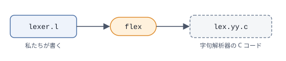

### 図 1-5. トークン列 → AST（構文解析）

- **場所**: 1.3 bison 入門 と parser.y の冒頭（最初の項より前）（`docs/jp/ch01/03_bison.md` 9 行目）
- **種類**: フロー図

```
INT  IDENT(main)  '('  ')'  '{'  RETURN  INT_LIT(42)  ';'  '}'
                                  ↓ 構文解析器
                          FUNC_DEF main
                            BLOCK
                              RETURN
                                INT_LIT 42
```

SVG 版（日本語 `docs/images/diagrams/jp/fig-1-5.svg`、英語 `docs/images/diagrams/en/fig-1-5.svg`）:

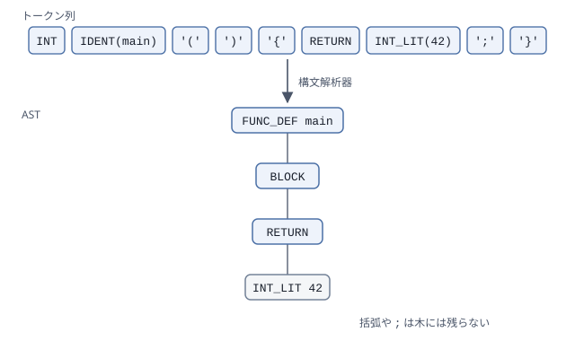

### 図 1-6. parser.y → bison → parser.tab.c / parser.tab.h

- **場所**: 1.3 bison 入門 と parser.y の冒頭（最初の項より前）（`docs/jp/ch01/03_bison.md` 20 行目）
- **種類**: フロー図

```
parser.y  ─ bison ─→  parser.tab.c   （構文解析器の C コード）
                      parser.tab.h   （トークン定義のヘッダ）
```

SVG 版（日本語 `docs/images/diagrams/jp/fig-1-6.svg`、英語 `docs/images/diagrams/en/fig-1-6.svg`）:

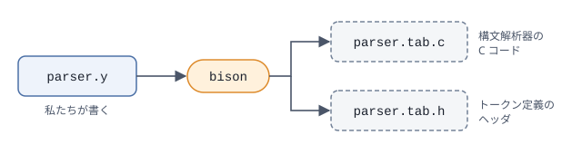

### 図 1-7. パースの追跡 1: INT_LIT がノードになる

- **場所**: 1.3.7 パースを追ってみる（`docs/jp/ch01/03_bison.md` 357 行目）
- **種類**: フロー図

```
INT_LIT(42) ──→ INT_LIT(42) ノード
```

SVG 版（日本語 `docs/images/diagrams/jp/fig-1-7.svg`、英語 `docs/images/diagrams/en/fig-1-7.svg`）:

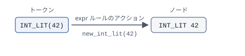

### 図 1-8. パースの追跡 2: RETURN ノードができる

- **場所**: 1.3.7 パースを追ってみる（`docs/jp/ch01/03_bison.md` 362 行目）
- **種類**: 木構造図

```
RETURN ── INT_LIT(42)ノード ── ';' 
               ↓
           RETURN ノード
           └─ INT_LIT(42) ノード
```

SVG 版（日本語 `docs/images/diagrams/jp/fig-1-8.svg`、英語 `docs/images/diagrams/en/fig-1-8.svg`）:

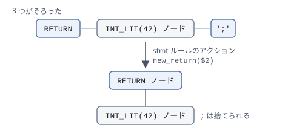

### 図 1-9. パースの追跡 3: 完成した木

- **場所**: 1.3.7 パースを追ってみる（`docs/jp/ch01/03_bison.md` 372 行目）
- **種類**: 木構造図

```
           FUNC_DEF main
           └─ BLOCK
               └─ RETURN
                   └─ INT_LIT 42
```

SVG 版（日本語 `docs/images/diagrams/jp/fig-1-9.svg`、英語 `docs/images/diagrams/en/fig-1-9.svg`）:

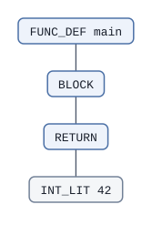

### 図 1-10. 入力ファイル → yyin → yylex → yyparse → program

- **場所**: 1.3.9 flex と bison の連携（`docs/jp/ch01/03_bison.md` 413 行目）
- **種類**: ブロック図

```
+-----------+
| 入力ファイル |   tiny-c で書かれたソース (例: `int main() { return 42; }`)
+-----+-----+
      |
      v
+-----------+
|  yyin     |   FILE * 型のグローバル変数
+-----+-----+
      |
      v
+-----------+
|  yylex()  |   flex 生成。1回呼ぶと1トークン返す
+-----+-----+
      |
      v
+-----------+
|  yyparse()|   bison 生成。yylex を内部で呼びながら木を作る
+-----+-----+
      |
      v
+-----------+
|  program  |   グローバル変数。AST の根が入る
+-----------+
```

SVG 版（日本語 `docs/images/diagrams/jp/fig-1-10.svg`、英語 `docs/images/diagrams/en/fig-1-10.svg`）:

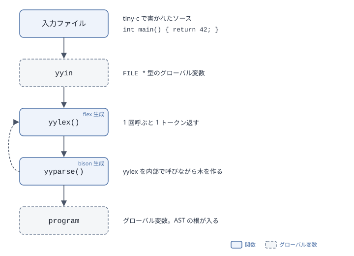

### 図 1-11. "return 42;" と RETURN ノード

- **場所**: 1.4.1 なぜ「木」なのか（`docs/jp/ch01/04_ast.md` 14 行目）
- **種類**: 木構造図

```
"return 42;"           RETURN ノード
                        └─ INT_LIT ノード（値: 42）
```

SVG 版（日本語 `docs/images/diagrams/jp/fig-1-11.svg`、英語 `docs/images/diagrams/en/fig-1-11.svg`）:

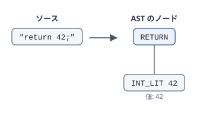

### 図 1-12. メモリ上のノードとポインタのつながり

- **場所**: 1.4.7 AST が組み立てられる様子（`docs/jp/ch01/04_ast.md` 352 行目）
- **種類**: 木構造図

```
program ──→ [D: FUNC_DEF "main"]
              │
              body: [C: BLOCK]
                      │
                      stmts: [L: NodeList]
                              │
                              node: [B: RETURN]
                                      │
                                      expr: [A: INT_LIT 42]
```

SVG 版（日本語 `docs/images/diagrams/jp/fig-1-12.svg`、英語 `docs/images/diagrams/en/fig-1-12.svg`）:

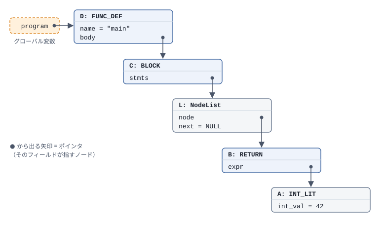

### 図 1-13. %rax / %eax / %ax の入れ子

- **場所**: 1.5.2 レジスタ ── CPU の中の作業箱（`docs/jp/ch01/05_codegen.md` 53 行目）
- **種類**: ブロック図

```
+----------------------+
|         %rax         |   ← 64 ビット全体
+----------+----------+
            |   %eax   |   ← 下位 32 ビット
            +---+------+
                | %ax  |   ← 下位 16 ビット
                +------+
```

SVG 版（日本語 `docs/images/diagrams/jp/fig-1-13.svg`、英語 `docs/images/diagrams/en/fig-1-13.svg`）:

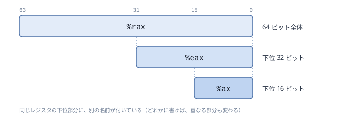

### 図 1-14. pushq %rbp の前後のスタック

- **場所**: 1.5.4 関数とスタック ── 値はどこに置くか（`docs/jp/ch01/05_codegen.md` 99 行目）
- **種類**: スタック図

```
高アドレス  ┌──────────────┐
           │              │
           │              │
           │     ...      │  ← push 前の %rsp はここ（直前のスタック先端）
           ├──────────────┤
           │ caller の rbp │  ← push 後の %rsp はここ（8 バイト下に動いた）
           ├──────────────┤
           │              │
低アドレス  └──────────────┘
```

SVG 版（日本語 `docs/images/diagrams/jp/fig-1-14.svg`、英語 `docs/images/diagrams/en/fig-1-14.svg`）:

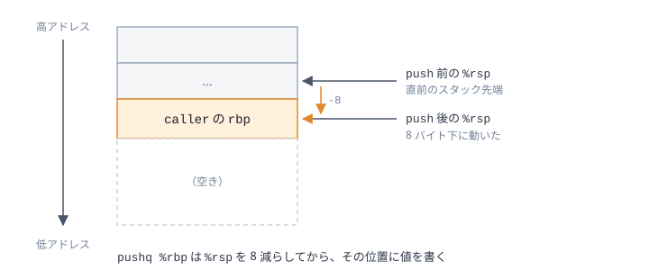

### 図 1-15. lexer → parser → AST → codegen と main.c の関係

- **場所**: 1.6.1 役割分担（`docs/jp/ch01/06_build.md` 10 行目）
- **種類**: ブロック図

```
+---------+                                                +---------+
| 入力 .c |                                                | 出力 .s |
+----+----+                                                +----+----+
     |                                                          ^
     v                                                          |
+----------+   +-----------+   +-------+   +-----------+   +----+----+
|  lexer   |─→ |  parser   |─→ |  AST  |─→ | codegen   |─→ |   FILE  |
| (flex)   |   | (bison)   |   |       |   |           |   |  (stdout)|
+----------+   +-----------+   +-------+   +-----------+   +---------+
                  ^                            ^
                  |                            |
            +-----+----+                +------+-----+
            | main.c   |                | main.c     |
            | yyparse  |                | codegen()  |
            +----------+                +------------+
```

SVG 版（日本語 `docs/images/diagrams/jp/fig-1-15.svg`、英語 `docs/images/diagrams/en/fig-1-15.svg`）:

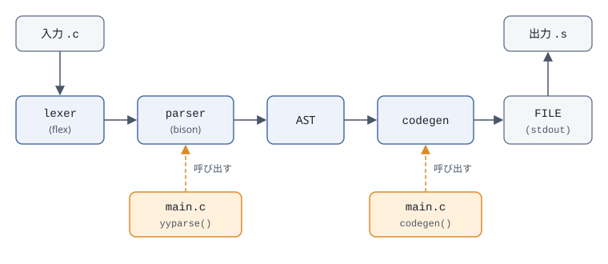

### 図 1-16. ビルド依存グラフ（ソース → .o → tinyc）

- **場所**: 1.6.5 ビルド依存グラフ（`docs/jp/ch01/06_build.md` 300 行目）
- **種類**: フロー図

```
src/parser.y ─→ build/parser.tab.c ─→ build/parser.tab.o ──┐
            └─→ build/parser.tab.h ─┐                        │
                                    │                        │
src/lexer.l ────────────────────────┴→ build/lex.yy.c ─→ build/lex.yy.o ──┤
                                                                          │
src/ast.c    ─────────────────────────────────────→ build/ast.o ─────────┤
                                                                          │
src/codegen.c ────────────────────────────────────→ build/codegen.o ─────┤
                                                                          │
src/main.c   ─────────────────────────────────────→ build/main.o ────────┤
                                                                          ↓
                                                                       tinyc
```

SVG 版（日本語 `docs/images/diagrams/jp/fig-1-16.svg`、英語 `docs/images/diagrams/en/fig-1-16.svg`）:

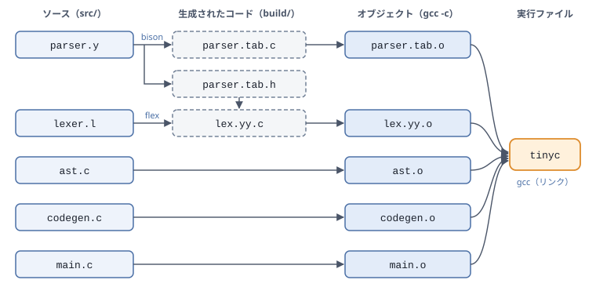

---

## 第2章 — 電卓を作る

### 図 2-1. 2 + 3 * 4 の 2 通りの解釈

- **場所**: 2.1.1 素朴な書き方の問題（`docs/jp/ch02/01_precedence.md` 25 行目）
- **種類**: 木構造図

```
解釈A:  expr             解釈B:  expr
        / | \                    / | \
     expr + expr             expr * expr
       2  / | \              / | \   4
        expr * expr        expr + expr
          3     4            2     3
```

SVG 版（日本語 `docs/images/diagrams/jp/fig-2-1.svg`、英語 `docs/images/diagrams/en/fig-2-1.svg`）:

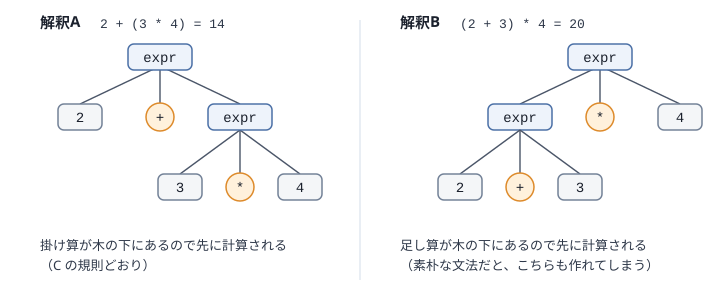

### 図 2-2. 10 - 3 - 2 の左結合の木

- **場所**: 2.1.3 結合性も文法で決まる（`docs/jp/ch02/01_precedence.md` 128 行目）
- **種類**: 木構造図

```
add_expr
├─ add_expr ← "10 - 3"
│  ├─ add_expr ← "10"
│  ├─ '-'
│  └─ mul_expr ← "3"
├─ '-'
└─ mul_expr ← "2"
```

SVG 版（日本語 `docs/images/diagrams/jp/fig-2-2.svg`、英語 `docs/images/diagrams/en/fig-2-2.svg`）:

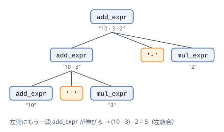

### 図 2-3. 2 + 3 * 4 の評価中のスタックの変化

- **場所**: 2.3.8 生成アセンブリを追う（`docs/jp/ch02/03_build.md` 394 行目）
- **種類**: スタック図

```
時刻 0: []
時刻 1: pushq %rax (=4)         → [4]
時刻 2: popq  %rcx               → []         (rcx=4, 内部計算で使う)
時刻 3: pushq %rax (=12)         → [12]
時刻 4: popq  %rcx               → []         (rcx=12)
```

SVG 版（日本語 `docs/images/diagrams/jp/fig-2-3.svg`、英語 `docs/images/diagrams/en/fig-2-3.svg`）:

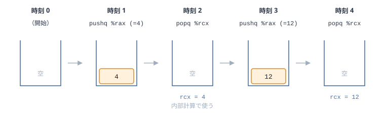

### 図 2-4. AST と生成アセンブリの対応

- **場所**: 2.3.8 生成アセンブリを追う（`docs/jp/ch02/03_build.md` 406 行目）
- **種類**: 木構造図

```
BINARY +                       <-- 一番最後の addl に対応
├─ INT_LIT 2                   <-- "movl $2, %eax"   (2回目)
└─ BINARY *                    <-- 内側の imull
   ├─ INT_LIT 3                <-- "movl $3, %eax"
   └─ INT_LIT 4                <-- "movl $4, %eax"   (1回目)
```

SVG 版（日本語 `docs/images/diagrams/jp/fig-2-4.svg`、英語 `docs/images/diagrams/en/fig-2-4.svg`）:

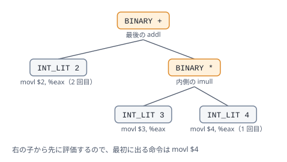

---

## 第3章 — 変数

### 図 3-1. x, y を置いたスタックフレーム

- **場所**: 第3章の表紙「まず動かしてみる」（`docs/jp/ch03/00_overview.md` 93 行目）
- **種類**: スタック図

```
            ↑ 高アドレス
   ┌──────────────────────┐
   │  呼び出し元の戻り番地  │  +8(%rbp)
   ├──────────────────────┤
   │  保存された呼び出し元の %rbp │  0(%rbp)  ← %rbp はここを指す
   ├──────────────────────┤
   │  x = 1               │  -8(%rbp)   ← 1 番目の subq $8 で確保
   ├──────────────────────┤
   │  y = 2               │  -16(%rbp)  ← %rsp はここ（2 番目の subq $8 で確保）
   ├──────────────────────┤
   │  （空き）              │
   ↓ 低アドレス
```

SVG 版（日本語 `docs/images/diagrams/jp/fig-3-1.svg`、英語 `docs/images/diagrams/en/fig-3-1.svg`）:

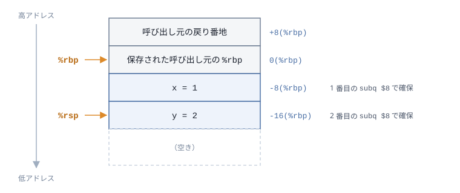

### 図 3-2. プロローグ直後のスタックフレーム

- **場所**: 3.2.2 ローカル変数の置き場所（`docs/jp/ch03/02_codegen.md` 38 行目）
- **種類**: スタック図

```
            高アドレス
           +---------+
           |  ...    |
           +---------+
           | 戻り番地 |   call 命令で積まれた（call 直後は %rsp がここを指す）
           +---------+
   %rbp →  | 旧 %rbp  |   pushq %rbp で積まれた（その後 movq %rsp, %rbp で %rbp はここを指す）
           +---------+
   %rsp →  |         |   （空きスタック）
           |         |
           | ...     |
           低アドレス
```

SVG 版（日本語 `docs/images/diagrams/jp/fig-3-2.svg`、英語 `docs/images/diagrams/en/fig-3-2.svg`）:

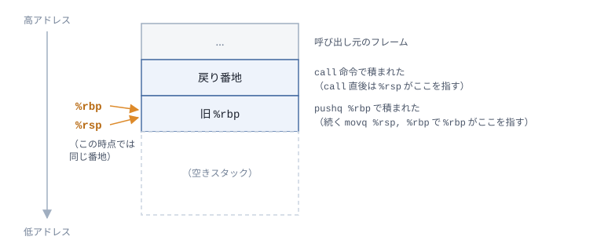

### 図 3-3. ローカル変数 x, y, z のスロット

- **場所**: 3.2.2 ローカル変数の置き場所（`docs/jp/ch03/02_codegen.md` 55 行目）
- **種類**: スタック図

```
   %rbp →    | 旧 %rbp  |
             +---------+
   -8(%rbp)  |    x    |     int x  (1つ目)
             +---------+
   -16(%rbp) |    y    |     int y  (2つ目)
             +---------+
   -24(%rbp) |    z    |     int z  (3つ目)
             +---------+
   %rsp →    |         |
```

SVG 版（日本語 `docs/images/diagrams/jp/fig-3-3.svg`、英語 `docs/images/diagrams/en/fig-3-3.svg`）:

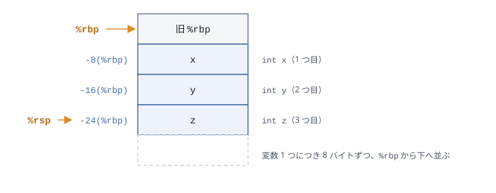

### 図 3-4. x = x + 5; の AST

- **場所**: 3.2.7 NODE_EXPR_STMT の codegen（`docs/jp/ch03/02_codegen.md` 218 行目）
- **種類**: 木構造図

```
EXPR_STMT
└─ ASSIGN
   ├─ IDENT x
   └─ BINARY +
      ├─ IDENT x
      └─ INT_LIT 5
```

SVG 版（日本語 `docs/images/diagrams/jp/fig-3-4.svg`、英語 `docs/images/diagrams/en/fig-3-4.svg`）:

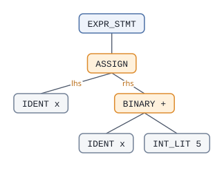

### 図 3-5. a = b = 7; の AST（連鎖代入）

- **場所**: 3.2.8 連鎖代入を見てみる（`docs/jp/ch03/02_codegen.md` 252 行目）
- **種類**: 木構造図

```
ASSIGN
├─ IDENT a
└─ ASSIGN
   ├─ IDENT b
   └─ INT_LIT 7
```

SVG 版（日本語 `docs/images/diagrams/jp/fig-3-5.svg`、英語 `docs/images/diagrams/en/fig-3-5.svg`）:

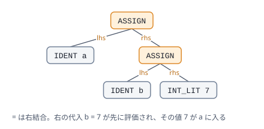

---

## 第4章 — 分岐とループ

### 図 4-1. if-else の AST

- **場所**: 4.1.7 AST 例（`docs/jp/ch04/01_grammar.md` 222 行目）
- **種類**: 木構造図

```
IF
├─ BINARY >          ← 条件
│  ├─ IDENT x
│  └─ INT_LIT 0
├─ EXPR_STMT         ← then 部
│  └─ ASSIGN
│     ├─ IDENT y
│     └─ INT_LIT 1
└─ EXPR_STMT         ← else 部
   └─ ASSIGN
      ├─ IDENT y
      └─ INT_LIT 2
```

SVG 版（日本語 `docs/images/diagrams/jp/fig-4-1.svg`、英語 `docs/images/diagrams/en/fig-4-1.svg`）:

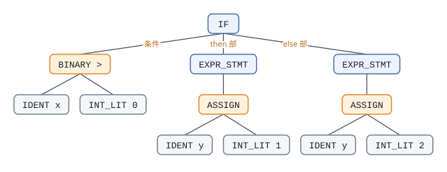

### 図 4-2. while の AST

- **場所**: 4.1.7 AST 例（`docs/jp/ch04/01_grammar.md` 248 行目）
- **種類**: 木構造図

```
WHILE
├─ BINARY <          ← 条件
│  ├─ IDENT i
│  └─ INT_LIT 10
└─ EXPR_STMT         ← 本体
   └─ ASSIGN
      ├─ IDENT i
      └─ BINARY +
         ├─ IDENT i
         └─ INT_LIT 1
```

SVG 版（日本語 `docs/images/diagrams/jp/fig-4-2.svg`、英語 `docs/images/diagrams/en/fig-4-2.svg`）:

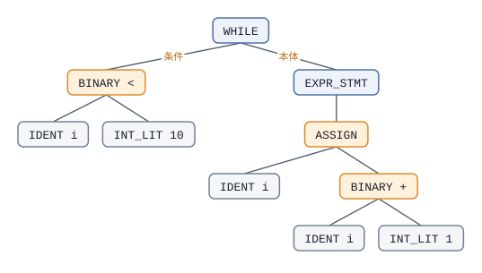

---

## 第5章 — 関数を呼ぶ・作る

### 図 5-1. パラメータ spill とパディングを含むフレーム

- **場所**: 5.3.5 フレームのレイアウト（`docs/jp/ch05/03_frame.md` 170 行目）
- **種類**: スタック図

```
高アドレス
 +---------------+
 | 戻り番地       |  ← caller の call が積んだ
 +---------------+
 | 旧 %rbp       |  ← 自分の pushq %rbp が積んだ。続く movq %rsp, %rbp で %rbp はここを指す
 +---------------+
 | n (= %edi)    |  -8(%rbp)   ← パラメータ spill
 +---------------+
 | (使われない)   |  -16(%rbp)  ← 16-aligned のためのパディング。subq $16 で %rsp はここを指す
 +---------------+
 |               |
 | (一時値の     |
 |  push/pop で  |
 |  伸び縮み)    |
 |               |
低アドレス
```

SVG 版（日本語 `docs/images/diagrams/jp/fig-5-1.svg`、英語 `docs/images/diagrams/en/fig-5-1.svg`）:

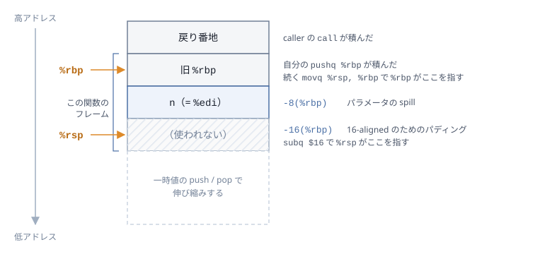

### 図 5-2. fact(5) → fact(4) → fact(3) の再帰フレーム

- **場所**: 5.4.8 再帰呼び出しが「自然に」動く理由（`docs/jp/ch05/04_call.md` 250 行目）
- **種類**: スタック図

```
高アドレス
 +-------------+
 | main の rbp |
 +-------------+
 | rip = main  |
 | rbp の保存  |
 | n=5         |   ← fact(5) のフレーム
 +-------------+
 | rip = fact  |
 | rbp の保存  |
 | n=4         |   ← fact(4) のフレーム
 +-------------+
 | rip = fact  |
 | rbp の保存  |
 | n=3         |   ← fact(3) のフレーム
 +-------------+
 | ...         |
低アドレス
```

SVG 版（日本語 `docs/images/diagrams/jp/fig-5-2.svg`、英語 `docs/images/diagrams/en/fig-5-2.svg`）:

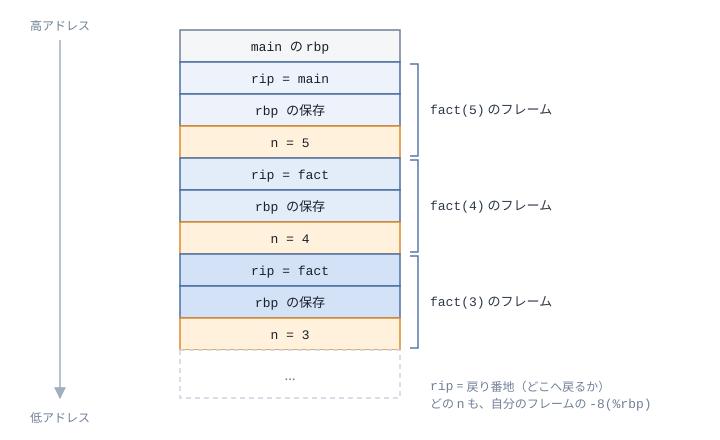

---

## 第6章 — ポインタと配列

### 図 6-1. a[i] = ... の codegen の呼び出し経路

- **場所**: 6.2.4 lvalue 側 ── アドレス取得 (`gen_addr`) の「6.2.4.3 に至る経路 ── `a[i]` と `*(p+i)` で違う」（`docs/jp/ch06/02_lvalue.md` 208 行目）
- **種類**: 木構造図

```
gen_stmt(EXPR_STMT)
└─ gen_expr(NODE_ASSIGN)        ← 入口
    ├─ gen_addr(node->lhs)       ← lhs = NODE_INDEX(a, i)
    │  └─ case NODE_INDEX        ← ★ 6.2.4.3 に到達
    │     ├─ gen_addr(IDENT a)   ← 6.2.4.1（配列のベースアドレス）
    │     ├─ gen_expr(IDENT i)
    │     ├─ imulq $4, %rax     ← スケーリング!
    │     └─ addq → %rax = &a[i]
    └─ ... store
```

SVG 版（日本語 `docs/images/diagrams/jp/fig-6-1.svg`、英語 `docs/images/diagrams/en/fig-6-1.svg`）:

![図 6-1 a[i] = ... の codegen の呼び出し経路](docs/images/diagrams/jp/fig-6-1.svg)

### 図 6-2. *(p + i) = ... の codegen の呼び出し経路

- **場所**: 6.2.4 lvalue 側 ── アドレス取得 (`gen_addr`) の「6.2.4.3 に至る経路 ── `a[i]` と `*(p+i)` で違う」（`docs/jp/ch06/02_lvalue.md` 222 行目）
- **種類**: 木構造図

```
gen_stmt(EXPR_STMT)
└─ gen_expr(NODE_ASSIGN)        ← 入口
    ├─ gen_addr(node->lhs)       ← lhs = NODE_UNARY '*'
    │  └─ case NODE_UNARY '*'    ← 6.2.4.2 に到達（6.2.4.3 ではない!）
    │     └─ gen_expr(operand)   ← operand = NODE_BINARY '+'
    │        └─ case NODE_BINARY ← ここの処理は 6.2.4.3 にも 6.2.4.2 にも入らず、ただの addl
    │           ├─ gen_expr(rhs = i)
    │           ├─ gen_expr(lhs = p)
    │           └─ addl %ecx, %eax  ← スケーリングなし!
    └─ ... store
```

SVG 版（日本語 `docs/images/diagrams/jp/fig-6-2.svg`、英語 `docs/images/diagrams/en/fig-6-2.svg`）:

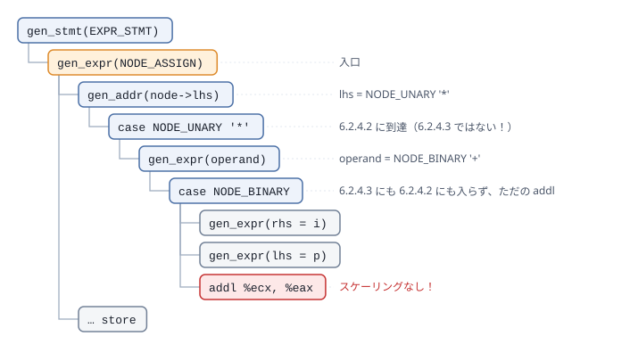

---

## 第7章 — 最適化とバックパッチ

### 図 7-1. ch07 のパイプライン（AST 最適化とピープホールの位置）

- **場所**: 第7章の表紙「はじめに」（`docs/jp/ch07/00_overview.md` 24 行目）
- **種類**: フロー図

```
ソース → 字句解析 → 構文解析 → AST → [AST 最適化] → codegen → asm → [ピープホール] → 出力 asm
                                  ↑                  ↑                  ↑
                                  ch07 で追加        単一パス化         ch07 で追加
                                                     (バックパッチ)
```

SVG 版（日本語 `docs/images/diagrams/jp/fig-7-1.svg`、英語 `docs/images/diagrams/en/fig-7-1.svg`）:

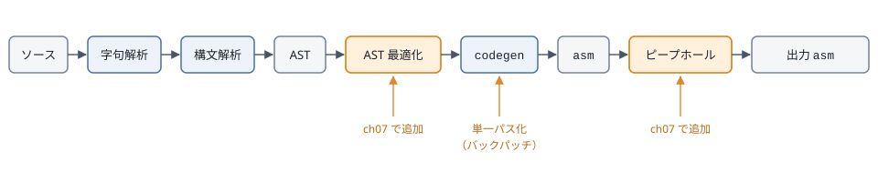

### 図 7-2. 定数畳み込み: 2 + 3 → 5

- **場所**: 7.1.1 定数畳み込み (Constant folding)（`docs/jp/ch07/01_const_fold.md` 11 行目）
- **種類**: 木構造図

```
BINARY +              →   INT_LIT 5
├─ INT_LIT 2
└─ INT_LIT 3
```

SVG 版（日本語 `docs/images/diagrams/jp/fig-7-2.svg`、英語 `docs/images/diagrams/en/fig-7-2.svg`）:

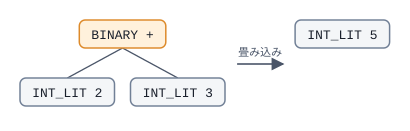

### 図 7-3. 定数畳み込み: 2 + 3 * 4 → 14

- **場所**: 7.1.1 定数畳み込み (Constant folding)（`docs/jp/ch07/01_const_fold.md` 19 行目）
- **種類**: 木構造図

```
BINARY +              →   BINARY +              →   INT_LIT 14
├─ INT_LIT 2              ├─ INT_LIT 2
└─ BINARY *               └─ INT_LIT 12
   ├─ INT_LIT 3
   └─ INT_LIT 4
```

SVG 版（日本語 `docs/images/diagrams/jp/fig-7-3.svg`、英語 `docs/images/diagrams/en/fig-7-3.svg`）:

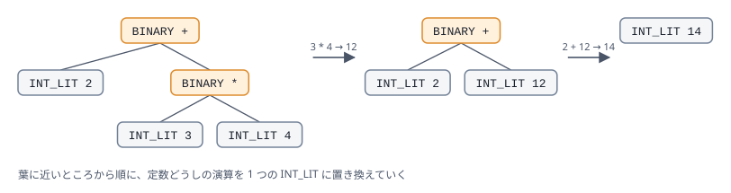

### 図 7-4. codegen → メモリバッファ → peephole → stdout

- **場所**: 7.4.1 パイプラインの中の位置（memstream の復習）（`docs/jp/ch07/04_peephole.md` 11 行目）
- **種類**: フロー図

```
codegen → メモリバッファ (open_memstream) → peephole → stdout
                   ↑                            ↑
              ch07/02 で導入             この節で追加
```

SVG 版（日本語 `docs/images/diagrams/jp/fig-7-4.svg`、英語 `docs/images/diagrams/en/fig-7-4.svg`）:

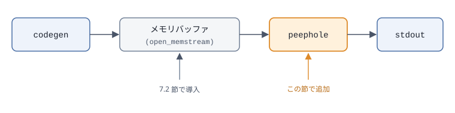
