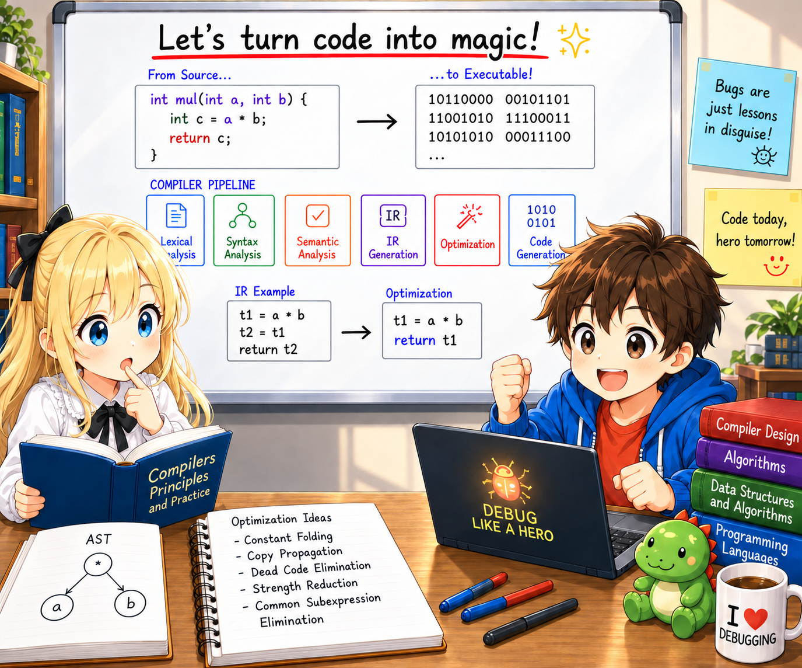
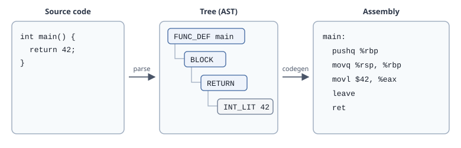
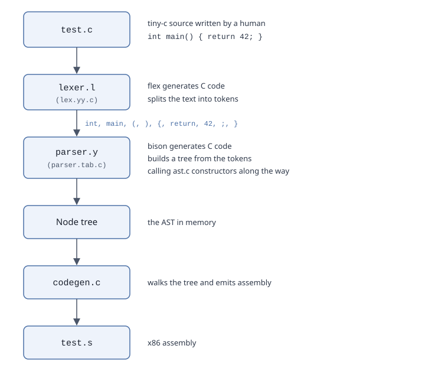

# Chapter 1 — A compiler that just returns 42

## Introduction — this chapter is special

We're going to build **a compiler for a tiny subset of C**. The goal is **to understand how compilers work by assembling one with your own hands**. We start with a very small compiler and add features as the chapters progress.

The compiler we build in Chapter 1 can compile exactly one kind of program:

```c
int main() {
    return 42;
}
```

No addition. No variables. No `if`, no `while`. The only thing allowed after `return` is a single integer literal.

Even so, every part that a real compiler has is already in there:

- Read the source and break the characters into tokens (**lexical analysis**)
- Read the structure of the token stream and build it into a tree (**parsing**)
- Walk the tree and emit x86 assembly (**code generation**)

If you link the emitted assembly with `gcc`, you get an executable. Its exit code is 42.

From Chapter 2 onward we put flesh on this skeleton, but **the skeleton itself carries through to the end**. That's why Chapter 1 alone is split into six sections.

| Section | Contents |
|--------|------|
| [1.1](01_regex.md) | Regular expressions — the minimum needed for flex |
| [1.2](02_flex.md) | Intro to flex + detailed walkthrough of the lexer `lexer.l` |
| [1.3](03_bison.md) | Intro to bison + detailed walkthrough of the parser `parser.y` |
| [1.4](04_ast.md) | What an abstract syntax tree is + detailed walkthrough of `ast.h` / `ast.c` |
| [1.5](05_codegen.md) | The minimum of x86 assembly + detailed walkthrough of `codegen.c` |
| [1.6](06_build.md) | `main.c` and `Makefile` — bringing it all together |

Throughout these docs, each `chNN/` folder is a **chapter**, each file in it (such as `01_regex.md`) is a **section**, and each numbered heading inside a section is a **subsection**. Sections and subsections are numbered by joining the chapter, section, and subsection numbers with dots, as in "Section 4.1" and "4.1.2".


## Run it first

Source file `test.c`:

```c
int main() {
    return 42;
}
```

Feed it to the compiler `tinyc` and out comes x86 assembly:

```bash
$ ./tinyc test.c
  .text
  .globl main
main:
  pushq %rbp
  movq %rsp, %rbp
  movl $42, %eax
  leave
  ret
```

Hand that assembly to `gcc` and you get an executable. `gcc` invokes the linker (which stitches a program together) and the assembler (which turns assembly into machine code) internally for you.

```bash
$ ./tinyc test.c > test.s
$ gcc -o test test.s
$ ./test
$ echo $?
42
```

`echo $?` is the shell idiom for "show the exit code of the last program." The C source `return 42;` has genuinely become "a program that exits with code 42."


## Peeking inside with `--dump-ast`

tinyc has a `--dump-ast` option that prints the tree structure (**AST**, Abstract Syntax Tree) the compiler builds internally.

```bash
$ ./tinyc --dump-ast test.c
FUNC_DEF main
  BLOCK
    RETURN
      INT_LIT 42
```

The source code `int main() { return 42; }` has been converted into this tree.

- At the top, "function definition `main`"
- Inside it, a "block `{...}`"
- Inside the block, a "return statement"
- The return statement's target: "integer literal 42"

The compiler first converts the source into this tree, then walks the tree to emit assembly. **Source → tree → assembly**, two stages.



Why route through a tree? In raw string form, extracting "the expression after `return`" is fiddly; on a tree you just say "the return node's child" and there it is. We convert it into a form that's easier to work with inside the compiler.


## The files we'll write

There are seven files in Chapter 1.

| File | What it does |
|---------|---------|
| `src/lexer.l` | Turns the **string** of source code into a stream of **tokens** (written in flex) |
| `src/parser.y` | Assembles the token stream into a **tree (AST)** (written in bison) |
| `src/ast.h` / `src/ast.c` | Node types of the tree, plus functions to build nodes |
| `src/codegen.h` / `src/codegen.c` | Walks the tree and emits **assembly** |
| `src/main.c` | Handles command-line arguments and ties the above together |
| `Makefile` | Build instructions for the compiler itself |


## The overall flow



`lexer.l` and `parser.y` are not C code as-is. **flex** and **bison** generate C source files (`lex.yy.c`, `parser.tab.c`) from these definition files. We then compile the generated C alongside our own C (`ast.c`, `codegen.c`, `main.c`) to produce an executable called `tinyc`.

To build a compiler, we use another compiler (gcc) and two code-generation tools (flex, bison).


## Assumed background

- **Basic C**: structs, pointers, functions, `malloc`/`calloc`.
- **Basic shell usage**: `cd`, `make`, `echo`, `./prog`, etc.

Things we don't assume — we cover them inline as needed:

- Regular expressions (→ [Section 1.1](01_regex.md))
- How to use flex (→ [Section 1.2](02_flex.md))
- How to use bison (→ [Section 1.3](03_bison.md))
- x86 assembly (→ [Section 1.5](05_codegen.md))


## Target environment

The target is **x86-64 Linux**. The emitted assembly is x86-64, and the calling convention is the System V AMD64 ABI.

On Mac (Apple Silicon) or Windows the compiler itself (`tinyc`) still builds and runs — it just emits assembly as a string, so it can run anywhere. But to turn that assembly into an executable you need an x86-64 Linux environment (Docker or WSL is the easiest way).

If you only want to check the AST with `--dump-ast`, anything works.


## Next

In the next section (`01_regex.md`) we cover the basics of **regular expressions** — just the amount that flex needs.

---

**Next:** [1.1 Regular expression basics](01_regex.md)
