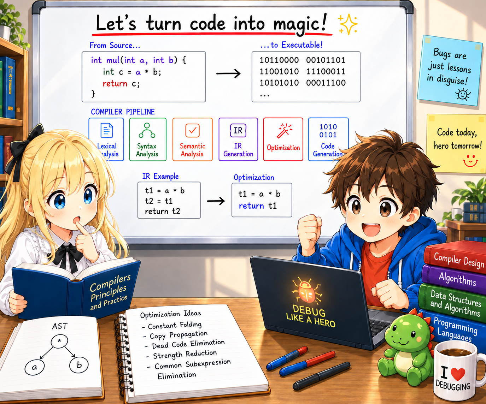

# 第1章 — 42を返すだけのコンパイラ

## はじめに — この章だけは特別

これから **C 言語の超サブセットを処理するコンパイラ** を作る。目的は **コンパイラの仕組みを自分の手で組み立てて理解する** ことにある。最初は小さなコンパイラから始めて、章が進むごとに機能を足していく。

第1章で作るコンパイラがコンパイルできるのは、たった一種類のプログラムだけ。

```c
int main() {
    return 42;
}
```

足し算もできない。変数も使えない。`if` も `while` もない。`return` の後に書けるのは整数リテラル一個だけ。

それでも、本物のコンパイラが持つ要素はすべて入っている。

- ソースコードを読んで、文字をトークンに分解する（**字句解析**）
- トークン列の構造を理解して、木のかたちに組み立てる（**構文解析**）
- 木を辿って、x86 アセンブリを出力する（**コード生成**）

出力されたアセンブリを `gcc` でリンクすれば、実行ファイルができる。終了コードは 42 になる。

第2章以降では、この骨格に肉をつけていく。**この骨格が、最後まで通用する**。そのため第1章だけは6つの節に分けて説明する。

| 節 | 内容 |
|--------|------|
| [1.1](01_regex.md) | 正規表現の基礎 — flex で使う最小限の知識 |
| [1.2](02_flex.md) | flex 入門 + 字句解析器 `lexer.l` の詳説 |
| [1.3](03_bison.md) | bison 入門 + 構文解析器 `parser.y` の詳説 |
| [1.4](04_ast.md) | 抽象構文木とは何か + `ast.h` / `ast.c` の詳説 |
| [1.5](05_codegen.md) | x86 アセンブリ最小限 + `codegen.c` の詳説 |
| [1.6](06_build.md) | `main.c` と `Makefile` — 全体を組み上げる |

このドキュメントでは、`chNN/` フォルダ 1 つを **章**、その中のファイル 1 つ（`01_regex.md` など）を **節**、節の中の番号付き見出しを **項** と呼ぶ。節は「4.1 節」、項は「4.1.2」のように、章・節・項の番号をドットでつないで書く。


## まず動かしてみる

ソースファイル `test.c`:

```c
int main() {
    return 42;
}
```

このコンパイラ `tinyc` に渡すと、x86 アセンブリが出てくる。

```bash
$ ./tinyc test.c
  .text
  .globl main
main:
  pushq %rbp
  movq %rsp, %rbp
  movl $42, %eax
  leave
  ret
```

このアセンブリを `gcc` に渡せば、実行ファイルになる。`gcc` はリンカ（プログラムをまとめる道具）と、アセンブラ（アセンブリを機械語に変える道具）を内部で呼んでくれる。

```bash
$ ./tinyc test.c > test.s
$ gcc -o test test.s
$ ./test
$ echo $?
42
```

`echo $?` は直前のプログラムの終了コードを表示するシェルの記法。`return 42;` という C のソースコードが、本当に「終了コード 42 で終わるプログラム」になった。


## `--dump-ast` で内部を覗く

tinyc には `--dump-ast` オプションがある。コンパイラが内部で作る木構造（**AST**, Abstract Syntax Tree）が表示される。

```bash
$ ./tinyc --dump-ast test.c
FUNC_DEF main
  BLOCK
    RETURN
      INT_LIT 42
```

ソースコード `int main() { return 42; }` がこの木に変換されている。

- 一番上は「関数定義 `main`」
- その中に「ブロック `{...}`」
- ブロックの中に「return 文」
- return 文の対象として「整数リテラル 42」

コンパイラは、ソースコードをまずこの木に変換し、それからこの木を辿ってアセンブリを生成する。**ソースコード → 木 → アセンブリ** の二段階。

```
ソースコード         木 (AST)              アセンブリ
"int main() {        FUNC_DEF main         main:
  return 42;            BLOCK                 pushq %rbp
}"                        RETURN              movq %rsp, %rbp
                            INT_LIT 42        movl $42, %eax
                                              leave
                                              ret
```

なぜ木を経由するか。文字列のままだと「`return` の後ろにある式」を取り出すのが面倒だが、木なら「return ノードの子」と言えばすぐ取り出せる。コンパイラの中で扱いやすい形に変換しておく。


## これから作るファイル

第1章で書くファイルは全部で7つ。

| ファイル | 何をする |
|---------|---------|
| `src/lexer.l` | ソースコードの**文字列**を**トークン**の列に変える（flex で書く） |
| `src/parser.y` | トークンの列を**木 (AST)** に組み立てる（bison で書く） |
| `src/ast.h` / `src/ast.c` | 木のノードの型と、ノードを作る関数 |
| `src/codegen.h` / `src/codegen.c` | 木を辿って**アセンブリ**を出力する |
| `src/main.c` | コマンドライン引数を処理し、上記をまとめて呼ぶ |
| `Makefile` | コンパイラ自身をビルドする手順 |


## 全体の流れ

```
+-----------+
| test.c    |  人間が書いた tiny-c ソース / int main() { return 42 ; }
+-----+-----+
      |
      v
+-----------+
| lexer.l   |  flex がCコードを生成
| (lex.yy.c)|  → 文字列をトークンに分解
+-----+-----+
      | int, main, (, ), {, return, 42, ;, }
      v
+-----------+
| parser.y  |  bison がCコードを生成
|(parser.tab|  → トークン列から木を組み立てる
| .c)       |  途中で ast.c のコンストラクタを呼ぶ
+-----+-----+
      |
      v
+-----------+
| Node 木   |  メモリ上の AST
+-----+-----+
      |
      v
+-----------+
| codegen.c |  木を辿ってアセンブリを出力
+-----+-----+
      |
      v
+-----------+
| test.s    |  x86 アセンブリ
+-----------+
```

`lexer.l` と `parser.y` は、そのままでは C のコードではない。**flex** と **bison** がこれらの定義ファイルから C のソースコード（`lex.yy.c`、`parser.tab.c`）を自動生成する。生成された C コードを、自分で書いた C コード（`ast.c`、`codegen.c`、`main.c`）と一緒にコンパイルすれば、`tinyc` という実行ファイルができる。

コンパイラを作るために別のコンパイラ（gcc）と二つの自動生成ツール（flex、bison）を使う。


## 必要な前提知識

- **C 言語の基礎**: 構造体、ポインタ、関数、`malloc`/`calloc`。
- **シェルの基本操作**: `cd`、`make`、`echo`、`./prog` など。

前提としないものは、本章の中で必要な分だけ説明する。

- 正規表現（→ [1.1 節](01_regex.md)）
- flex の使い方（→ [1.2 節](02_flex.md)）
- bison の使い方（→ [1.3 節](03_bison.md)）
- x86 アセンブリ（→ [1.5 節](05_codegen.md)）


## 動作環境

ターゲットは **x86-64 Linux**。生成されるアセンブリは x86-64、呼び出し規約は System V AMD64 ABI。

Mac (Apple Silicon) や Windows でもコンパイラ自体（`tinyc`）はビルド・動作する。アセンブリを「文字列として」吐き出すだけだから、どこで動かしてもよい。ただし出てきたアセンブリを実行ファイルに変換するには x86-64 Linux 環境が必要（Docker や WSL が手軽）。

`--dump-ast` で AST を確認するだけなら、どんな環境でも動く。


## 次へ

次の節（`01_regex.md`）では、flex で使う分の **正規表現** の基礎を押さえる。

---

**次へ:** [1.1 正規表現の基礎](01_regex.md)
