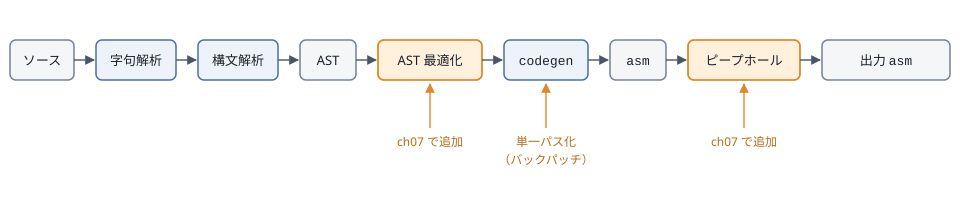

# 第7章 — 最適化とバックパッチ

## はじめに

ch01 から ch06 までのアセンブリには無駄が多い。

加えて ch06 までの codegen は **二相構成**（collect_locals → gen_stmt）だった。プロローグの `subq $N, %rsp` で N（フレームサイズ）が決まっていないと書けないので、先に AST を 1 回歩いて N を確定してから本体を出力する、という手順だ。

第 7 章では、これら 2 つの「課題」をまとめて解決する。鍵になるのは **アセンブリ出力をメモリバッファに溜める** こと。これだけで:

| テーマ | 内容 | バッファとの関係 |
|------|------|----------------|
| **AST 最適化**（7.1 節）| 定数畳み込み + 代数的単純化 | 直接は使わない（AST 上で完結） |
| **バックパッチ**（7.2 節、必須）| プロローグの `subq $N` を後埋め → codegen が単一パスに | バッファ上で `ftell` / `fseek` |
| **ブロックスコープ**（7.3 節）| 単一パス化の副産物として `{ int x=1; }{ int x=2; }` が通るように | 直接は使わない（codegen の流れに乗る） |
| **ピープホール最適化**（7.4 節）| 生成 asm を眺めて隣接命令を書き換える | バッファの内容を読んで再出力 |

バックパッチと最適化は **別物**。バックパッチは codegen の構造を単純化するための仕掛けで、出力されるコードの内容は変わらない。最適化は実際にコードを短くする。`--no-opt` で外せるのは AST 最適化とピープホールだけで、**バックパッチは常に有効**。ブロックスコープは言語機能の追加。

ch01〜ch06 で「コンパイラの中身（lexer → parser → AST → codegen）」を一通り作ったが、ch07 では:



asm はメモリバッファに書かれ、ピープホールで整形されてから stdout に流れる。バックパッチも同じバッファ上で行う。

## 効果のサンプル

`return 2 + 3 * 4;` のコンパイル結果:

**最適化なし** (11 行)

```asm
main:
  pushq %rbp
  movq %rsp, %rbp
  movl $4, %eax
  pushq %rax
  movl $3, %eax
  popq %rcx
  imull %ecx, %eax
  pushq %rax
  movl $2, %eax
  popq %rcx
  addl %ecx, %eax
  leave
  ret
```

**最適化あり** (5 行)

```asm
main:
  pushq %rbp
  movq %rsp, %rbp
  movl $14, %eax
  leave
  ret
```

`2 + 3 * 4` が **コンパイル時に 14 に畳まれ**、しかも末尾の暗黙 `return` の dead code も除去された結果。実行命令数も減る。

`printf("hello\n")` も:

**最適化なし**: `pushq %rax; popq %rdi` が残る。
**最適化あり**: `movq %rax, %rdi` 1 命令に置き換わり、末尾の dead code も消える。

## ch06 との差分

| ファイル | 変更 |
|---------|------|
| `lexer.l` / `parser.y` / `ast.h` / `ast.c` | **変更なし** |
| `codegen.c` | **二相 → 単一パス**（`collect_locals` 削除）、プロローグを `ftell`/`fseek` でバックパッチ、ブロックスコープ追加（`enter_scope` / `exit_scope`）|
| `optimize.h` / `optimize.c` | **新規** ── `optimize_ast` と `peephole` の2関数 |
| `main.c` | 常に `open_memstream` を使う、`--no-opt` 対応、ピープホールを通す |
| `Makefile` | `optimize.c` をビルド対象に追加 |

最適化（AST + ピープホール）は **完全に別パス** として codegen の前後に挟まる。バックパッチは codegen の **内部構造の改善** で、外から見れば二相が一相になっただけ ── 出力されるコードは ch06 と同じ。ブロックスコープは **言語機能の追加** で、バックパッチで単一パス化したことで自然に乗る。

## 使い方

```bash
$ ./tinyc test.c              # 最適化あり（デフォルト）
$ ./tinyc --no-opt test.c     # 最適化なし（比較用）
$ ./tinyc --dump-ast test.c   # 最適化後の AST を表示
$ ./tinyc --no-opt --dump-ast test.c  # 最適化前の AST を表示
```

`--no-opt` オプションがあるので、ビフォー・アフターを直接見比べられる。ch07 の docs ではこの形でデモを示す。

## 節の構成

| 節 | 内容 |
|--------|------|
| [7.1](01_const_fold.md) | AST レベル最適化 — 定数畳み込み + 代数的単純化 |
| [7.2](02_backpatch.md) | バックパッチで Phase 1 を消す — プロローグの `subq $N` を後埋めし、codegen を単一パスに |
| [7.3](03_scope.md) | ブロックスコープ — 単一パス化したことで自然に乗る、locals 連結リストの head 切り戻し（スロット再利用付き） |
| [7.4](04_peephole.md) | ピープホール最適化 — 生成 asm を眺めて書き換える |
| [7.5](05_build.md) | 全ファイルの差分、ビルド、最適化前後の比較 |

## 次へ

7.1 節（`01_const_fold.md`）では、AST 最適化の中身を見る。`2 + 3 * 4` がなぜ codegen に渡る前に `14` になるか、`x + 0` がなぜ `x` だけに化けるか ── 仕組みは小さな再帰関数1つ。

---

**次へ:** [7.1 AST レベル最適化（定数畳み込み + 代数的単純化）](01_const_fold.md)
